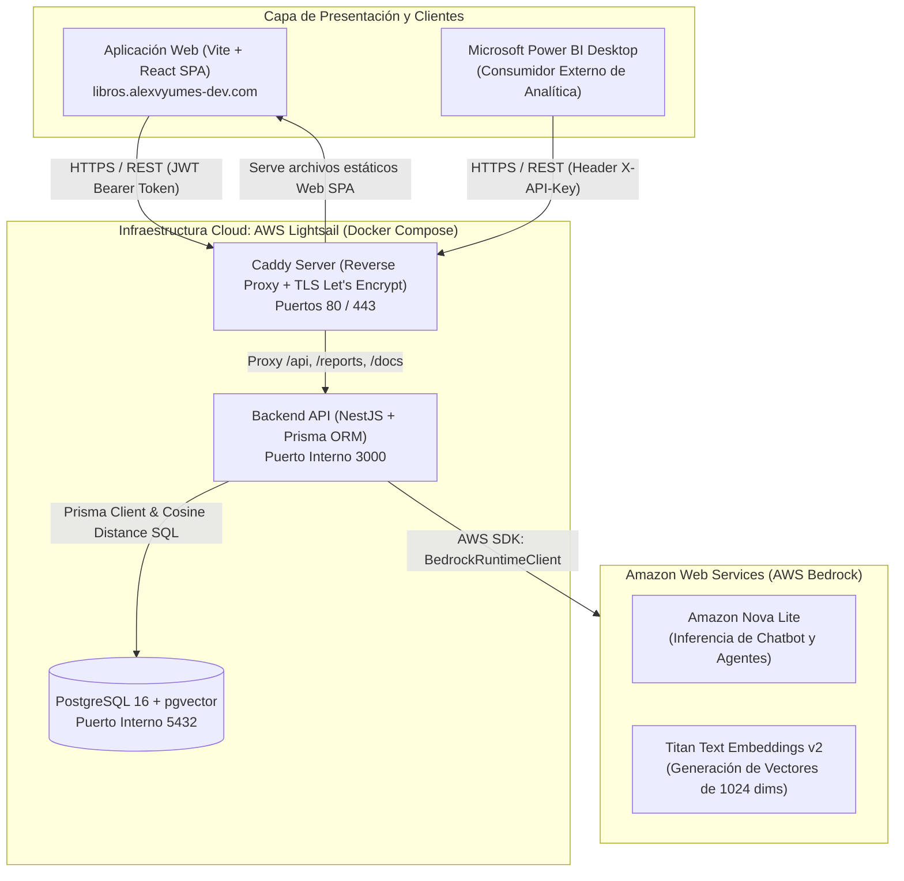
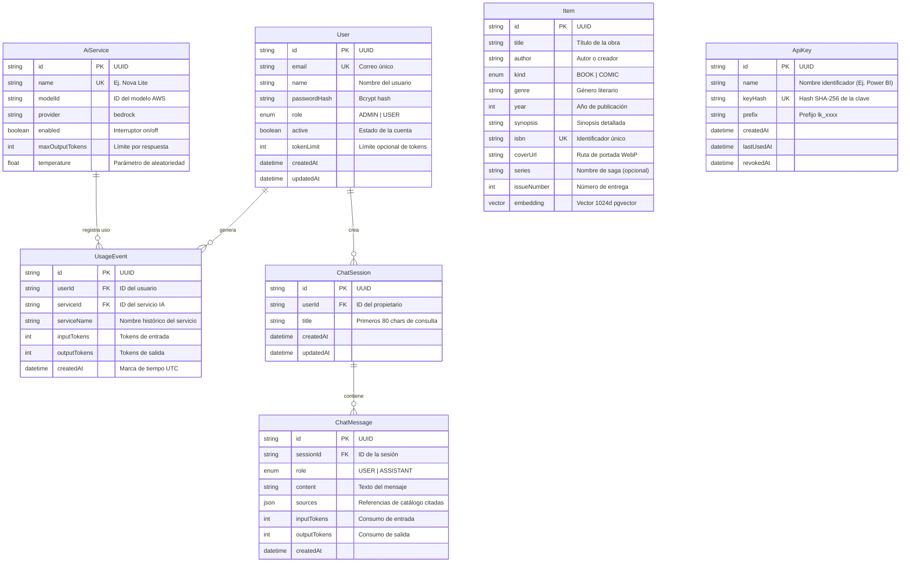

# Proyecto Final: Libros & Cómics AI — Plataforma Web con Servicios de Inteligencia Artificial

**Materia:** Programación Comercial / Sistemas de Información  
**Fecha de Entrega:** 10 de noviembre de 2026  
**Autor:** Alexander Vásquez (Alexvy)  
**Dominio de Producción:** [https://libros.alexvyumes-dev.com](https://libros.alexvyumes-dev.com)  
**API REST y Documentación Swagger:** [https://apilibros.alexvyumes-dev.com/docs](https://apilibros.alexvyumes-dev.com/docs)  
**Repositorio GitHub:** [https://github.com/Alexter2003/libros-ai](https://github.com/Alexter2003/libros-ai)

---

## 1. Propuesta de la Aplicación

### 1.1 Objetivo del Proyecto
Desarrollar una solución web integral y modular para la consulta, recomendación y exploración de un catálogo literario de libros y cómics, potenciada por **tres servicios de Inteligencia Artificial Generativa** y modelos de lenguaje de última generación mediante Amazon Bedrock:
1. **Chatbot con RAG (Retrieval-Augmented Generation)**: Asistente conversacional con memoria contextual que fundamenta sus respuestas exclusivamente en el catálogo de obras almacenado en la base de datos vectorial.
2. **Agente Recomendador Semántico**: Agente inteligente de varios pasos que interpreta en lenguaje natural los gustos del usuario, filtra candidatos mediante similitud semántica y sintetiza hasta tres recomendaciones personalizadas con justificaciones específicas.
3. **Agente de Orden de Lectura**: Agente multi-etapa que localiza series o sagas completas en el catálogo, calcula de forma determinista la cronología óptima de lectura y genera una explicación clara sobre la continuidad de los tomos.

Asimismo, la plataforma incorpora un **control riguroso de consumo de tokens y cuotas por usuario**, auditoría administrativa de consultas, documentación exhaustiva vía **Swagger/OpenAPI** y un canal de ingesta externa seguro mediante **API Keys** para la generación de dashboards analíticos en **Power BI**.

### 1.2 Usuarios Destinatarios
- **Lectores y Usuarios Registrados (Rol `USER`)**:
  - Explorar el catálogo de libros y cómics con información editorial, números de tomo y sinopsis.
  - Conversar con el Chatbot RAG para resolver dudas sobre títulos, argumentos y temáticas.
  - Utilizar los agentes de IA para descubrir nuevas lecturas o conocer el orden cronológico de sagas.
  - Consultar en cualquier momento su propio consumo acumulado de tokens y el balance restante de su cuota.
- **Administradores del Sistema (Rol `ADMIN`)**:
  - Gestionar el catálogo editorial (creación, edición y eliminación de libros y cómics).
  - Administrar usuarios, activar/desactivar accesos y asignar límites personalizados de cuota de tokens.
  - Configurar los servicios de Inteligencia Artificial (activar o deshabilitar modelos según costos o disponibilidad).
  - Auditar el reporte general de consultas y tokens agrupado por usuario, fecha y servicio.
  - Generar y revocar API Keys para herramientas analíticas externas (Power BI).

### 1.3 Fuentes de Datos e Información
- **Base de Datos Relacional y Vectorial**: PostgreSQL 16 con la extensión `pgvector`, alojada en contenedor Docker en AWS Lightsail.
- **Catálogo Editorial Demo**: Colección curada de más de 55 obras literarias y cómics organizados en sagas completas (*Sandman*, *Watchmen*, *Dune*, *Cien Años de Soledad*, *Batman*, *Saga*, etc.) con sinopsis extensas y portadas optimizadas en WebP.
- **Vectores de Incrustación (Embeddings)**: Vectores densos de 1024 dimensiones generados mediante el modelo fundacional `amazon.titan-embed-text-v2:0` sobre el título, autor, género, serie y sinopsis de cada ítem.

---

## 2. Arquitectura de la Solución

### 2.1 Diagrama de Arquitectura
La arquitectura sigue el patrón de **Monorepo desacoplado** gestionado con `pnpm`, compuesto por un frontend SPA en React, un backend modular en NestJS, una base de datos PostgreSQL con `pgvector`, un proxy inverso Caddy con gestión automática de certificados SSL/TLS y comunicación con Amazon Bedrock.

### 2.2 Recorrido de una Solicitud
1. **Desde la GUI Web (Ejemplo: Pregunta al Chatbot RAG)**:
   - El usuario envía un mensaje desde la interfaz `/chat`.
   - La petición viaja con el encabezado `Authorization: Bearer <JWT>`.
   - Caddy valida el protocolo TLS y redirige la petición a la API NestJS.
   - `AuthGuard` valida la sesión del usuario; `TokenQuotaService` verifica que el usuario no haya alcanzado su límite de tokens (si lo superó, responde `429 Too Many Requests`).
   - La API genera el vector de la pregunta con Titan Embeddings v2 y ejecuta una búsqueda por distancia coseno (`Item.embedding <=> queryVector`) en PostgreSQL.
   - Si no se alcanza la similitud mínima (`0.18`), se responde inmediatamente que no hay información suficiente sin gastar tokens generativos.
   - Si hay coincidencias relevantes, se construye un prompt delimitado por contexto y se invoca a Amazon Nova Lite.
   - Se registran los tokens consumidos en `UsageEvent`, se almacena el mensaje con sus fuentes en `ChatMessage` y se devuelve la respuesta al usuario.

2. **Desde un Consumidor Externo (Power BI)**:
   - Power BI ejecuta una petición `GET https://apilibros.alexvyumes-dev.com/reports/usage` con la cabecera `X-API-Key: lk_...`.
   - Caddy transfiere la petición a la API.
   - `AuthGuard` detecta la presencia del decorador `@AllowApiKey()`, calcula el hash SHA-256 de la clave y consulta la tabla `ApiKey`. Si la clave es válida y no está revocada, actualiza `lastUsedAt` y autoriza la petición con rol de solo lectura.
   - `UsageService` ejecuta una agregación agrupada por día (UTC), usuario y servicio de IA, devolviendo un arreglo JSON plano listo para su modelado en Power BI.

---

## 3. Modelo de Datos

### 3.1 Diagrama Entidad-Relación (Prisma ORM)

---

## 4. Servicios de Inteligencia Artificial

### 4.1 Chatbot con RAG (Retrieval-Augmented Generation)
- **Recuperación Vectorial**: Cálculo en tiempo real de similitud coseno sobre la columna `embedding` de tipo `vector(1024)`.
- **Detección de Información Insuficiente**: Si los ítems recuperados no alcanzan un umbral mínimo de similitud de `0.18`, el sistema responde con un mensaje honesto indicando que el catálogo no cuenta con dicha información, evitando alucinaciones y consumo innecesario de tokens.
- **Citación de Fuentes**: Cada respuesta generada devuelve las fichas de los libros o cómics consultados con su enlace directo en el catálogo.
- **Memoria Conversacional**: Se persiste el historial por sesión (`ChatSession` y `ChatMessage`), permitiendo preguntas de seguimiento manteniendo el contexto de la charla.

### 4.2 Agente de IA 1: Recomendador Personalizado
- **Funcionamiento**: Recibe un texto libre de hasta 1000 caracteres describiendo gustos, estado de ánimo o temáticas preferidas.
- **Mecanismo Multi-paso**:
  1. Extrae candidatos mediante búsqueda semántica vectorial en la base de datos (top 8 ítems más cercanos).
  2. Construye un prompt estructurado pidiendo al modelo seleccionar un máximo de 3 obras candidatas.
  3. Valida en backend que los IDs devueltos por el modelo existan en la lista de candidatos (descarta cualquier invención).
  4. Genera y retorna una tarjeta con la obra y una justificación en español.

### 4.3 Agente de IA 2: Orden de Lectura Cronológico
- **Funcionamiento**: Permite ingresar el nombre de una saga, serie o título de cómic.
- **Mecanismo Multi-paso**:
  1. Resuelve la serie buscando primero coincidencia exacta o parcial de texto en la tabla `Item`.
  2. Si no coincide el nombre directo, busca la obra más similar por embeddings para extraer su campo `series`.
  3. Ordena los volúmenes de manera **determinista en código TypeScript** por `issueNumber` ascendente, luego por año y título (evitando errores cronológicos del modelo).
  4. Utiliza el modelo generativo para redactar una explicación introductoria y resumida de la continuidad de la saga.

---

## 5. Control de Cuotas y Seguridad de la API

- **Límites de Tokens Preventivos**: Los administradores pueden asignar cuotas numéricas individuales (ej. 5,000 tokens) a cada usuario. El backend valida el consumo antes de invocar a los modelos y bloquea solicitudes excedidas con código HTTP `429 Too Many Requests`.
- **Interruptor de Servicios (On/Off)**: Si un servicio de IA es desactivado por el administrador, las peticiones que intenten usarlo son rechazadas de inmediato con código HTTP `422 Unprocessable Entity`.
- **Documentación Swagger Dual**: Disponible en `/docs`, permitiendo autenticación con Bearer Token (para usuarios) y `X-API-Key` (para reportes analíticos).

---

## 6. Integración con Power BI

El dashboard de **Power BI Desktop** se conecta directamente a la API REST de producción (`https://apilibros.alexvyumes-dev.com/reports/usage`) mediante el conector web con autenticación por encabezado `X-API-Key`.

### Replicación del Reporte Web y Validación
- **Métricas sincronizadas**:
  - Total de Tokens Consumidos (`TokensTotales`).
  - Total de Consultas Realizadas (`Consultas`).
  - Desglose de Tokens de Entrada vs. Salida.
- **Segmentadores Interactivos**:
  - Rango de fechas (desde / hasta).
  - Servicio de IA (Nova Lite, Titan Embeddings).
  - Usuario (email).
- **Resultados Coincidentes**: Los totales mostrados en las tarjetas KPI de Power BI coinciden exactamente con la tarjeta *"Totales del filtro"* de la pantalla web `/admin/usage`.

---

## 7. Pruebas Automatizadas y CI/CD

- **Pruebas Automatizadas**: 46 pruebas unitarias y de integración desarrolladas con Vitest en `apps/api/test/` (cubriendo cálculo de tokens, pasarela de IA con mocks de Bedrock, persistencia de sesiones y agregaciones de reportes).
- **Pipeline de Integración Continua (GitHub Actions)**:
  - Archivo `.github/workflows/ci.yml`.
  - En cada push a la rama `main`, ejecuta linting (ESLint), validación estricta de tipos (`tsc`) y la suite completa de pruebas.
  - Solo si todas las comprobaciones son satisfactorias, procede con el despliegue automático por SSH al servidor en AWS Lightsail.

---

## 8. Compilado de Evidencias de la Aplicación

*(En esta sección se insertan las capturas de pantalla de la aplicación en producción y herramientas auxiliares).*

### 8.1 Autenticación y Control de Acceso por Roles
- **Captura 1.1: Pantalla de Login y Registro**  
  *[Insertar captura de la pantalla de inicio de sesión]*
- **Captura 1.2: Vista de Usuario Regular vs. Administrador**  
  *[Insertar captura mostrando el menú completo con opciones de administración para ADMIN y vista simplificada para USER]*

### 8.2 Catálogo de Libros y Cómics
- **Captura 2.1: Cuadrícula del Catálogo con Portadas WebP**  
  *[Insertar captura del catálogo editorial en /]*
- **Captura 2.2: Modal de Gestión de Obras (CRUD)**  
  *[Insertar captura del formulario de creación o edición de un libro/cómic]*

### 8.3 Configuración de Servicios de IA y Asignación de Cuotas
- **Captura 3.1: Panel de Servicios de IA (Interruptor On/Off)**  
  *[Insertar captura de /admin/ai-services]*
- **Captura 3.2: Asignación de Límite de Tokens a Usuario**  
  *[Insertar captura del modal de cuota en /admin/users]*

### 8.4 Chatbot con RAG y Memoria Conversacional
- **Captura 4.1: Consulta con Respuesta Fundamentada y Tarjetas de Fuentes**  
  *[Insertar captura de /chat con fuentes citadas]*
- **Captura 4.2: Detección de Información Insuficiente en el Catálogo**  
  *[Insertar captura donde el chatbot indica honestamente que no cuenta con información de una obra no presente]*

### 8.5 Agentes de Inteligencia Artificial
- **Captura 5.1: Agente Recomendador Semántico**  
  *[Insertar captura de /agents (pestaña Recomendador) con recomendaciones generadas]*
- **Captura 5.2: Agente de Orden de Lectura**  
  *[Insertar captura de /agents (pestaña Orden de Lectura) con la cronología de una saga]*

### 8.6 Reporte de Consumo y Auditoría de Sesiones
- **Captura 6.1: Pantalla "Mi Consumo" del Usuario**  
  *[Insertar captura de /usage]*
- **Captura 6.2: Reporte Administrativo General con Filtros**  
  *[Insertar captura de /admin/usage mostrando totales filtrados y tabla]*

### 8.8 Documentación y Exploración de la API en Swagger
- **Captura 8.1: Swagger UI con Esquemas Duales de Autenticación**  
  *[Insertar captura de /docs mostrando los tags y el botón Authorize con Bearer y X-API-Key]*
- **Captura 8.2: Ejecución de Petición en Swagger con X-API-Key**  
  *[Insertar captura de la ejecución interactiva en Swagger respondiendo 200 OK con los datos]*

### 8.9 Dashboard en Microsoft Power BI
- **Captura 9.1: Dashboard General en Power BI Desktop**  
  *[Insertar captura del reporte con KPIs, gráficos de barras y segmentadores]*
- **Captura 9.2: Demostración de Resultados Coincidentes (Web vs. Power BI)**  
  *[Insertar captura comparativa de totales entre Power BI y /admin/usage]*

### 8.10 Pruebas y Pipeline de Despliegue CI/CD
- **Captura 10.1: Ejecución Satisfactoria de Vitest (46 tests pasados)**  
  *[Insertar captura de terminal ejecutando `pnpm test`]*
- **Captura 10.2: Flujo Verde en GitHub Actions**  
  *[Insertar captura del pipeline de GitHub Actions completado con éxito]*

